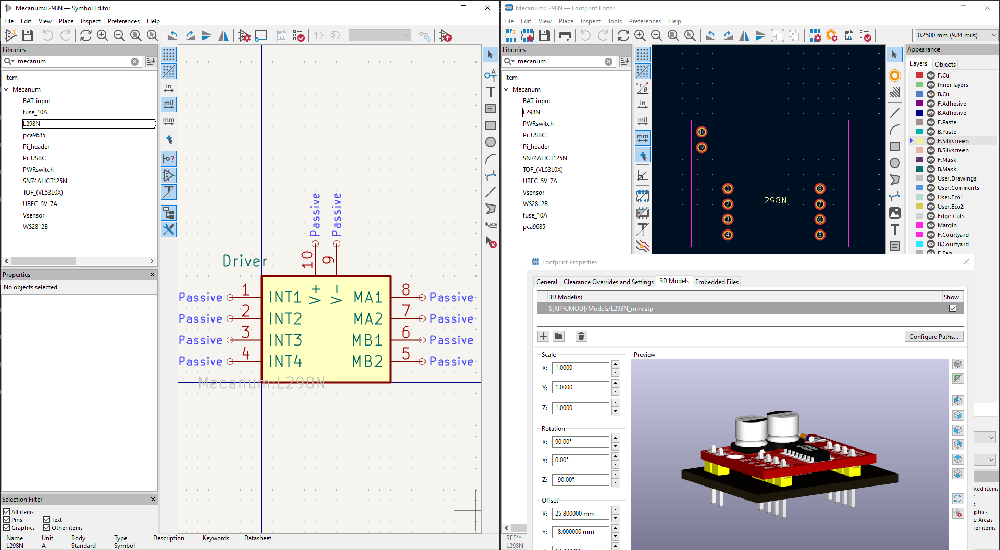

# 11/12/2026: Start on PCB and parts ordered.
**Total time spent:  7.13 hours**\
*Timelaps: [laps](https://lapse.hackclub.com/timelapse/b5X-v76ovdwz)*

Today I worked really hard to get the schematic of the PCB done and ready for review (asking people to review it, I like doing it since it helps to have second opinions).
Update on the parts: they were all ordered Sunday but that was all I did that day so I did not write a journal entry just for that.

As for the schematic, here are the specifications:

I created my own sybole lybrary using KiCad aswell as the footprint library to go with it.
A total of 12 components were created for the Shematic
- BAT-input, which is simply two THT pads that I will solder my deans T connector on.
- fuse 10A, which is the fuse footprint I needed to make for my 10A fuse.
- L298N, which is simply the motor drivers that I use, again I needed to make it's symbol and footprint.
- pca9685, since I am mounting it on my board, all the available symbols and footprints were for the chip and not the actual breakout board so I needed to make it myself.
- Pi_header, which is used to just plug all the GPIO pins that I will be using, which is a total of 9 according to the wiring diagram I made earlier.
- Pi_USBC, again just a 2 pad symbole and footprint so I can solder on a pigtail USBC connector to supply the Pi 5.
- PWRswitch, again two holes since I will be mounting the switch on my chasis and the leads will be connected with wires.
- SN7AHCT125N, the chip was not in KiCad so might as well make it and put it in my library.
- TOF_(VL53L0X), just a normal pin footprint and pin labelling for the TOF sensors that are also going to be used on the chasis and connected with wires.
- UBEC_5V_7A, 4 holes for all 4 wires the UBEC needs to all be wired up, same concept as the other 2 hole mounting strategy.
- Vsensor, this is the symbol and footprint for the voltage sensor.
- WS2812B, just a basic 6 prong LED for my library, I find it easier to use my own parts and footprints rather than the ones that were already available.

Anyways, after all the Libraries were done I started placing all the components that leaded to me finishing the PCB schematic in a single session, while writing this report I did remember I should add the 3D models for everything so that is what I did after this sentence.

I did make sure to take note of every model I used:
- https://grabcad.com/library/motor-driver-mini-l298n-1-5a-celebrating-10-000-downloads-1
- https://github.com/adafruit/Adafruit_CAD_Parts/tree/main/815%20Servo%20Driver%2016%20Channel
- https://grabcad.com/library/vl53l0x-4
- https://grabcad.com/library/ina219-2
- https://grabcad.com/library/blade-fuse-holder-1/details?folder_id=14244903
- https://grabcad.com/library/auto-fuse-1
- https://grabcad.com/library/2-54mm-male-pin-header-1/details?folder_id=14212673

Very productive day in the end, I will have to route the PCB eventually and same goes for making the CAD of the chasis.
The chasis takes priority since I want to have it done before or at the same time that my parts arrive.

**Pictures of the day (final schematic and screenshot of all my library symbols/footprints with the showcase of a model)**

# 11/06/2026: The beginning. Circuit layout and figuring out specifications.
**Total time spent: 3.5 hours**\
*Timelaps: [laps](https://lapse.hackclub.com/timelapse/GnB8wL3rzQjc)*\
New semester, new project.

This project is for my computer vision class.

The plan is simple, make an OpenCV controlled mecanum drive rover with collision detection which will have 3 ways it can be controlled:
1. Via an app I need to make, it will have basic mecanum drive based controls.
2. Using the collision detection to navigate the school hallways.
3. Using the OpenCV program I need to write for the class, identifying shapes and colors to navigate through a kind of maze/path with shapes randomly spread around.

The reason why I am using a mecanum drive rather than normal RWD, using TOF sensors, using KiCad to make a PCB when I don't need to, and using some WS2812B light strips, is because I honestly just want to make this project a little more interesting than a prebought chassis off of Amazon, I want to learn more and make more projects.

**Motor setup**
- Mine: 1:48 TT motors, all from one batch. I might need to change these out for 1:120 gear ratio but only testing will confirm
- Driver boards: 2× HW-354 mini dual H-bridge.

**Power system**
- Battery: 7.4 V 6000 mAh LiPo (2S, 8.4 V full).
- 10A fuse
- Motors are ≤6 V, PWM duty will be set at 6 / Vbat (71% at 8.4 V) to get an average voltage the motors can handle.
- INA219 breakout is used to measure the battery voltage, both to alert me of a low battery and allow me to set the correct duty cycle for the motors.
- UBEC 5 V 7 A → Pi 5 (USBC cable).
- Caps: 100 nF across each motor (x4), 100 nF at each driver (x2), 100 nF at 74AHCT125 pins 14–7, 470 µF 16 V on motor supply, 4700 µF 10 V after UBEC to Pi5.
- Grounds: logic ground pour (PCA9685, ToF, INA219, shifter), separate wide motor return, one junction at the battery.

**Sensors and PCA9685**
- 4× TOF200C (VL53L0X, 3–5 V boards) + 2 spares, powered from Pi 3.3 V.
- Boot sequence: all XSHUT low, each is woken up one at a time and addresses are set 0x30–0x33.
- XSHUT → Pi GPIO5/6/13/19 (header pins 29/31/33/35). Add 10 kΩ pull-ups to 3.3 V only if the TOF sensors don't have any.
  (they should, but I was never able to find datasheets for them so I will be sure when I see it myself).
- PCA9685 at 0x40: VCC 3.3 V, SDA, SCL, GND. OE low, V+ unused. Channels 0–7 → driver IN1–IN4 ×2. Outputs are push-pull and start low. Max PWM 1526 Hz.

**INA219 (battery voltage)**
- Address 0x41 (bridge A0).
- VCC → 3.3 V, GND → common ground, SDA/SCL shared.
- **VIN+ and VIN− both go to battery positive.** Bus voltage is read at VIN−.
- Safe first test: both VIN pins on 3.3 V, should read ~3.3.
- Library: `adafruit-circuitpython-ina219`.
- I am NOT routing motor current through it, too close to the breakout's limit and I only need voltage readings in the end.

**LED strip (WS2812B)**
- 5 V from UBEC. Data: Pi GPIO10 (pin 19) → 74AHCT125 pin 2.
- 74AHCT125: pin 14 = 5 V, pins 7 and 1 = GND, pin 3 → 330 Ω → DIN.
- Unused gates: pins 5, 9, 12 → GND. Pins 4, 10, 13 → 5 V.
- 10 kΩ from pin 2 to GND. To stop flickering when the Pi5 boots.
- Strip current: ~60 mA/LED max, trace width will be calculated when I decide on how long of a strip I want to use.

**PCB plan**
- HAT-style on the Pi 5, still need to check dimensions and see if it is possible.
- Notch for the camera ribbon, and stack mounting if possible.
- every breakout board will be removable and just slot onto the PCB.

**To do tomorrow**
- Finish the entirety of the CAD model of the car.
- Order parts after checking if they work with the CAD model of the car.
- If CAD is finished fast (likely not), making the PCB on KiCad is also on the list of things to do.

**Pictures of the day (final circuit layout, CAD and PCB schematic early stages)**

