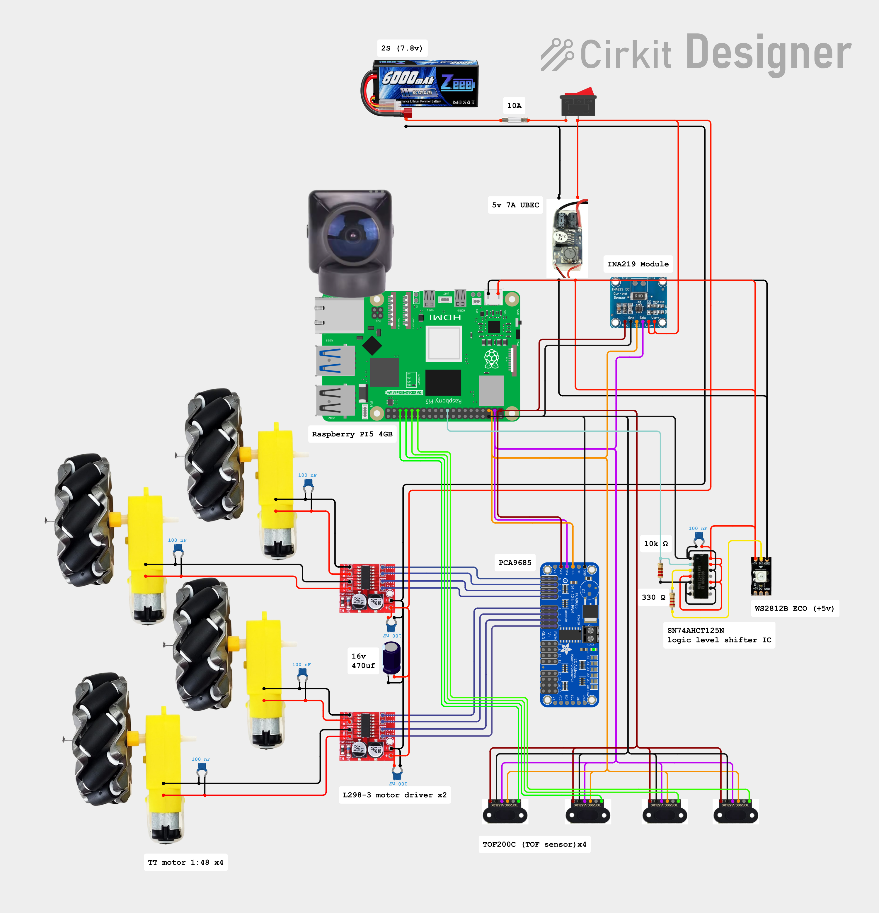
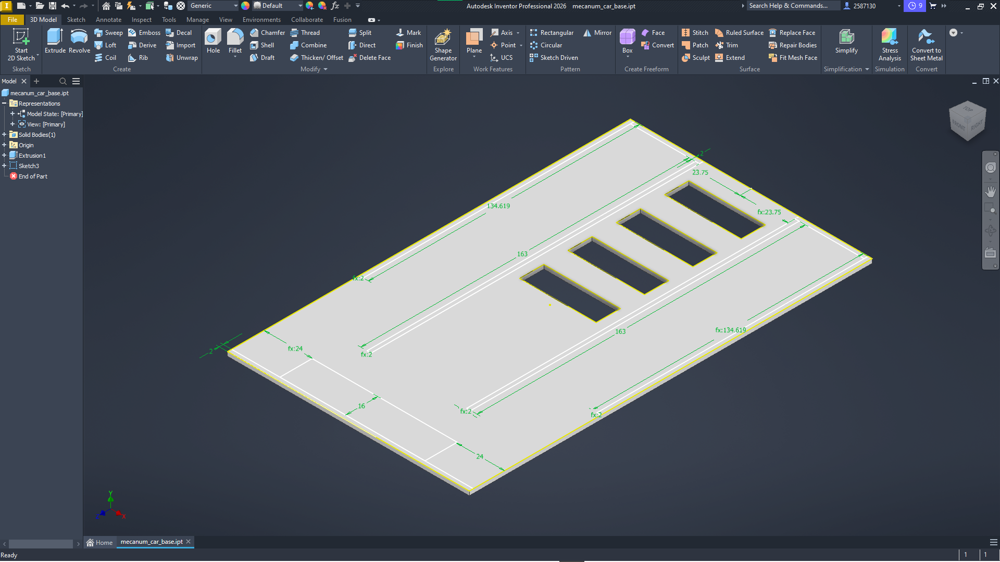
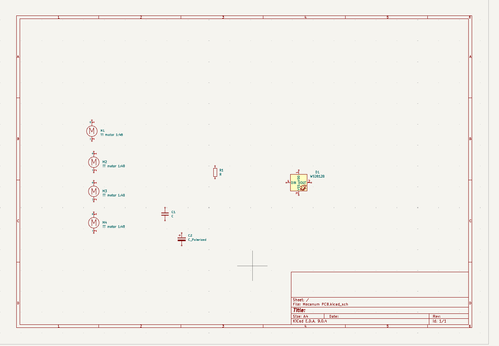

# 11/06/2026: The beginning. Circuit layout and figuring out specifications.
**Total time spent: 3.5 hours**\
*Timelaps: [laps](https://lapse.hackclub.com/timelapse/GnB8wL3rzQjc)*\
New semester, new project.

This project is for my computer vision class.

The plan is simple, make an OpenCV controlled mecanum drive rover with collision detection which will have 3 ways it can be controlled:
1. Via an app I need to make, it will have basic mecanum drive based controls.
2. Using the collision detection to navigate the school hallways.
3. Using the OpenCV program I need to write for the class, identifying shapes and colors to navigate through a kind of maze/path with shapes randomly spread around.

The reason why I am using a mecanum drive rather than normal RWD, using TOF sensors, using KiCad to make a PCB when I don't need to, and using some WS2812B light strips, is because I honestly just want to make this project a little more interesting than a prebought chassis off of Amazon, I want to learn more and make more projects.

**Motor setup**
- Mine: 1:48 TT motors, all from one batch. I might need to change these out for 1:120 gear ratio but only testing will confirm
- Driver boards: 2× HW-354 mini dual H-bridge.

**Power system**
- Battery: 7.4 V 6000 mAh LiPo (2S, 8.4 V full).
- 10A fuse
- Motors are ≤6 V, PWM duty will be set at 6 / Vbat (71% at 8.4 V) to get an average voltage the motors can handle.
- INA219 breakout is used to measure the battery voltage, both to alert me of a low battery and allow me to set the correct duty cycle for the motors.
- UBEC 5 V 7 A → Pi 5 (USBC cable).
- Caps: 100 nF across each motor (x4), 100 nF at each driver (x2), 100 nF at 74AHCT125 pins 14–7, 470 µF 16 V on motor supply, 4700 µF 10 V after UBEC to Pi5.
- Grounds: logic ground pour (PCA9685, ToF, INA219, shifter), separate wide motor return, one junction at the battery.

**Sensors and PCA9685**
- 4× TOF200C (VL53L0X, 3–5 V boards) + 2 spares, powered from Pi 3.3 V.
- Boot sequence: all XSHUT low, each is woken up one at a time and addresses are set 0x30–0x33.
- XSHUT → Pi GPIO5/6/13/19 (header pins 29/31/33/35). Add 10 kΩ pull-ups to 3.3 V only if the TOF sensors don't have any.
  (they should, but I was never able to find datasheets for them so I will be sure when I see it myself).
- PCA9685 at 0x40: VCC 3.3 V, SDA, SCL, GND. OE low, V+ unused. Channels 0–7 → driver IN1–IN4 ×2. Outputs are push-pull and start low. Max PWM 1526 Hz.

**INA219 (battery voltage)**
- Address 0x41 (bridge A0).
- VCC → 3.3 V, GND → common ground, SDA/SCL shared.
- **VIN+ and VIN− both go to battery positive.** Bus voltage is read at VIN−.
- Safe first test: both VIN pins on 3.3 V, should read ~3.3.
- Library: `adafruit-circuitpython-ina219`.
- I am NOT routing motor current through it, too close to the breakout's limit and I only need voltage readings in the end.

**LED strip (WS2812B)**
- 5 V from UBEC. Data: Pi GPIO10 (pin 19) → 74AHCT125 pin 2.
- 74AHCT125: pin 14 = 5 V, pins 7 and 1 = GND, pin 3 → 330 Ω → DIN.
- Unused gates: pins 5, 9, 12 → GND. Pins 4, 10, 13 → 5 V.
- 10 kΩ from pin 2 to GND. To stop flickering when the Pi5 boots.
- Strip current: ~60 mA/LED max, trace width will be calculated when I decide on how long of a strip I want to use.

**PCB plan**
- HAT-style on the Pi 5, still need to check dimensions and see if it is possible.
- Notch for the camera ribbon, and stack mounting if possible.
- every breakout board will be removable and just slot onto the PCB.

**To do tomorrow**
- Finish the entirety of the CAD model of the car.
- Order parts after checking if they work with the CAD model of the car.
- If CAD is finished fast (likely not), making the PCB on KiCad is also on the list of things to do.

**Pictures of the day (final circuit layout, CAD and PCB schematic early stages)**

